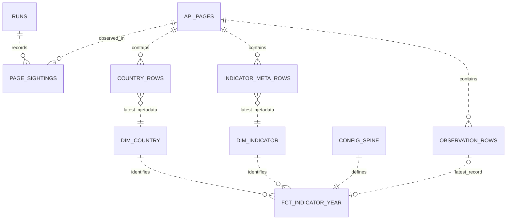

# World Bank indicators data model

Run from the repository root with `python -m wb_pipeline run` after `make setup`. On Windows use the interpreter at .venv/Scripts/python.exe. The run command ingests the source, builds and tests dbt models, then exports the marts and six reporting views. Ingest, transform and export are also independent CLI commands. Configuration paths resolve against the repository root. The dbt wrapper always supplies an absolute warehouse path and the indicator configuration, year bounds and consistency tolerance.

## Configuration and extension

The configuration selects nine countries, four indicators and years 2018 through 2024. Each indicator has a code, display label and category. Add a country to the countries list or add an indicator entry to the indicators list without changing Python or SQL. The API supplies country and indicator metadata. Unknown YAML keys, malformed ISO3 codes, duplicate keys and invalid numeric settings fail before creating a run. The configuration hash represents the normalized dataclasses, including resolved paths.

The complete fact grain is country ISO3, indicator code and calendar year. The default configuration has 9 x 4 x 7 = 252 expected rows, independently of source completeness. Historical source records outside the current configuration stay in raw storage. Current marts contain the current configuration only.

## Raw provenance and idempotency

raw.runs has one row per invocation of ingestion, keyed by a UTC timestamp plus six random hexadecimal characters. It stores lifecycle timestamps, running or success or failed status, configuration hash, pipeline version, the greatest source release date observed in that run, and failure notes. A run is successful after ingestion and, for a full run, dbt build. Export errors change the run status to failed. An ingestion only run is successful after ingestion.

raw.api_pages has one row per distinct request URL and body hash. The page_id is SHA256 of the UTF8 request URL concatenated with the hexadecimal SHA256 of the raw JSON body. Its run_id is the first sighting. It also stores pagination, HTTP status, source release date, first fetch timestamp and the complete response as a JSON column. Every fetch also writes the verbatim response text to the configured raw directory under its run_id, entity, request slug and page number. Request URLs include page numbers and all query parameters, so changing pagination or the configured country list produces different page identities.

raw.page_sightings has one row per page_id and run_id, with the fetch timestamp for that run. Repeated ingestion of unchanged responses adds sightings and a run without adding page or exploded record rows. File copies exist for each run even when a page is already in DuckDB.

raw.country_rows, raw.indicator_meta_rows and raw.observation_rows have the physical key page_id and zero based row_index. They preserve source strings alongside first ingestion provenance. Observation values are nullable DOUBLE. The source date, ISO codes, status, units and decimal metadata remain loosely typed until staging. Raw data is never replaced with fabricated zero values.

A complete paginated request is collected and validated before any of its pages are inserted. All pages, sightings and exploded rows from that request are inserted in one DuckDB transaction. A failure rolls the transaction back and marks the run failed. Files may remain for a rolled back request as forensic evidence. Earlier completed requests in a failed run remain auditable in raw storage. Existing mart tables are rebuilt only by dbt. Staging ignores failed runs, and uses successful runs plus the running invocation being transformed. Independent concurrent ingestion and transformation against the same warehouse are not supported.

raw.config_spine is replaced in one transaction after all requests finish. Its natural key is country_iso3, indicator_code and year, with config_sha256 on every row. It represents configuration rather than source data.

## Staging and dimensions

stg_countries keeps one row per ISO3 country, trims strings and parses latitude and longitude as nullable DOUBLE. stg_indicators keeps one row per indicator code with official definitions and attribution. stg_observations keeps one row per country, indicator and year, casting year to INTEGER and preserving nullable values and source row lineage.

All three staging views choose the most recent eligible page sighting. They join sightings to the original content rows so an unchanged response fetched after a changed response can become current again. Ties use the run start timestamp, page_id and row index for deterministic results. Staging deduplicates observation business keys without skipping explicit null values. An observation absent from a later response does not erase a previously returned observation, because the source history is append only and deduplication chooses the latest returned record.

dim_country is keyed by configured country_iso3 and left joins the latest metadata. A newly configured country without metadata still gets a dimension row with null descriptive attributes. dim_indicator is keyed by configured indicator_code, combines source metadata with configured label and category, and marks only SP.POP.TOTL and NY.GDP.MKTP.CD additive. Income groups come from current source country metadata and apply to every reporting year. They do not represent historical income group membership.

## Fact status semantics

fct_indicator_year is a table rebuilt from the entire config_spine and a left join to stg_observations. Its unique business key is country_iso3, indicator_code and year. It references the natural keys in both dimensions. loaded_at records build time; fetched_at identifies the latest eligible sighting; source_page_id and source_row_index link back to the exact raw record.

| Status | Meaning | Value | Provenance |
| :..- | :..- | :..- | :..- |
| present | The source returned a numeric value | Numeric, including zero if the source returns zero | Source page and row |
| null_value | The source returned a record with a null value | NULL | Source page and row |
| not_returned | No source record exists for this configured key | NULL | NULL |

is_missing is true for both missing statuses. Zero is never substituted for missingness. The configured population and GDP tests reject nonpositive present values rather than rewriting them.

## Reporting choices

rpt_missing_data lists every nonpresent key with its missingness reason. rpt_completeness_by_country_indicator uses the configured interval as its denominator, reports first and last present years, and preserves null endpoints when all values are missing.

rpt_yoy_change applies LAG over every configured year. A gap therefore produces prior_missing in the following year instead of comparing across the gap. The first configured year has first_year precedence. Later years use current_missing, then prior_missing, then prior_zero, then ok. Absolute change requires both values; percentage change is 100 times the relative change and is null unless status is ok.

rpt_latest_year_comparison chooses the latest year with at least one present value for each indicator across the selected countries. It returns every configured country for that common year, including null country values. If an indicator has no present values in any year, it has no common comparison year and contributes no rows. Descending ranks are null for missing values, and ties share a rank. share_of_total is a fraction of the selected countries present total for additive indicators only. Partial coverage is visible in the missingness and completeness reports.

rpt_latest_available_per_country chooses a separate latest present year for each country and indicator. A pair with no present values still has a row, with null year and value. This report can mix years and should not be used as a common year country comparison.

rpt_income_group_by_year groups only the configured countries, not all countries worldwide. Unknown income metadata uses the UNK code and Unknown label. country_count counts configured members; countries_present counts nonnull values. Sums, means, medians and extrema use present values. All missing groups retain null measurements, including sums. Population weights use SP.POP.TOTL from the same country and year. The weighted average is null if any group member has a missing or nonpositive population weight, and its denominator includes only countries with a present target value.

| Indicator | Preferred aggregate | Interpretation |
| :..- | :..- | :..- |
| Total population | sum_value | Population across selected countries with present values |
| GDP in current US dollars | sum_value | Nominal economic size across selected countries with present values |
| GDP per capita | population_weighted_avg | GDP per person across contributing countries |
| Life expectancy | population_weighted_avg | Descriptive population weighted average of country estimates, not a pooled life table |

Unweighted avg_value and median_value describe a typical country rather than a typical person. Examine countries_present and country_count before interpreting any aggregate. Current US dollar GDP comparisons are nominal and have no inflation adjustment.

## Relationships



## Quality and exports

dbt build runs business key uniqueness and null checks, fact dimension relationships, accepted status values, configured year bounds, population and GDP positivity, life expectancy bounds, exact spine cardinality, observation deduplication and GDP per capita consistency within the configured relative tolerance. Population annual movement beyond plus or minus ten percent warns without failing the build. The Python wrapper passes tolerance as a dbt variable and streams dbt output through run scoped logging.

Export writes the three mart tables, six reporting views and raw run history to ten Parquet files with Zstandard compression under dashboard/data. It also writes all six reporting views as CSV with empty null fields, plus outputs/run_summary.json with run identifiers, lifecycle timestamps and row counts per relation. Export ordering is deterministic; fetch, build and run timestamps change on each invocation. Run history Parquet is named run_summary.parquet.

## Offline testing and recording status

Tests set WB_OFFLINE_GUARD to 1. The client transport refuses to open a real connection in that mode, while responses intercepts mocked requests before the connection adapter. Fixture transport reads entity and slug and page numbered JSON files and never calls HTTP. Every pytest warehouse and raw output directory lives under pytest temporary storage.

The synthetic fixture directory is explicitly marked in every response metadata object. Its numbers and country attributes are fabricated test inputs, not World Bank measurements. It has one explicit null at ZAF, SP.DYN.LE00.IN, 2024 and one absent record at BRA, NY.GDP.PCAP.CD, 2024. Separate fixtures cover three page pagination, the error shaped API body and a 503 followed by a 200. Tests also cover 429, timeouts, exhausted retries, transaction rollback, repeated runs, ten configured countries, source lineage, exports and zero or missing prior years.

The recorded fixture set in tests/fixtures/live_2026-11-08 contains nine real API pages. All 252 configured observations are present in the October 8, 2026 source release. Observation pages have source_lastupdated 2026-10-08; country and indicator metadata pages have no release date. Live fixture tests build one temporary warehouse per module and verify completeness, current income group assignments, GDP per capita consistency and the reporting outputs. Synthetic fixture tests retain explicit null and absent cases independently of live completeness.

The synthetic warehouse is shared across the test session, including the first run of the idempotency test. Test builds invoke dbt through its programmatic runner, using the same dbt_vars helper as the production wrapper, so repeated builds reuse imported modules. Each build still runs all dbt models and tests with its own configured warehouse. The production CLI retains subprocess execution.

The verified dependency versions are DuckDB 1.5.6, dbt core 1.12.6, dbt duckdb 1.11.1, requests 2.32.5, PyYAML 6.0.3, pytest 8.4.2 and responses 0.25.8 on Python 3.11.9. Requirements retain the requested exact pins and patch ranges.

## Offline demo

The following command runs from the repository root in Git Bash or Linux. It writes a temporary YAML configuration for raw storage, then redirects the warehouse and exports using the optional CLI path overrides. The export directory contains Parquet files in its parquet subdirectory and CSV files and the JSON summary in its outputs subdirectory. Defaults remain unchanged when the flags are omitted. All demo data stays under one temporary directory, and the final JSON summary reports the run identifier, success status and relation counts.

```bash
wb_python=.venv/bin/python
if [ -f .venv/Scripts/python.exe ]; then wb_python=.venv/Scripts/python.exe; fi
"$wb_python" - <<'PY'
import os
from pathlib import Path
import subprocess
import sys
import tempfile
import yaml

root = Path(tempfile.mkdtemp(prefix="wb-offline-demo-"))
config = yaml.safe_load(Path("config/pipeline.yaml").read_text(encoding="utf-8-sig"))
config["paths"]["raw_dir"] = (root / "raw").as_posix()
path = root / "pipeline.yaml"
path.write_text(yaml.safe_dump(config), encoding="utf-8")
subprocess.run([
    sys.executable, "-m", "wb_pipeline", "run",
    "..offline-fixtures", "tests/fixtures/live_2026-11-08", "..config", str(path),
    "..duckdb-path", str(root / "warehouse.duckdb"), "..export-dir", str(root),
    "..duckdb-path", str(root / "warehouse.duckdb"), "..export-dir", str(root),
], check=True, env={**os.environ, "WB_OFFLINE_GUARD": "1"})
PY
```